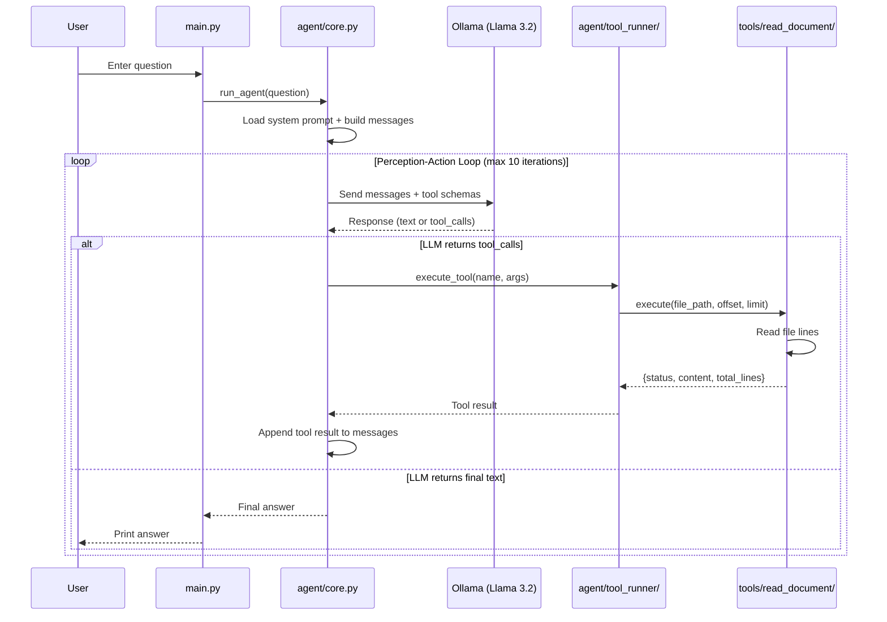

# Simple LLM Agent

A minimal AI agent that reads text documents and answers questions about them using a local LLM (Ollama + Llama 3.2).

The agent follows the **Perception-Action Loop** pattern: it receives a question, decides which tools to call, reads the document, and formulates an answer based only on what it read.

---

## 📐 Architecture

### Sequence Diagram



### Project Structure

```
simple-llm/
├── main.py                  # Entry point — takes user input, runs the agent
├── system_prompt.md         # System prompt — instructions for the LLM
├── test_document.txt        # Sample document the agent can read
│
├── agent/                   # Agent core logic
│   ├── __init__.py          # Re-exports run_agent
│   ├── config.py            # All settings (env variables with defaults)
│   ├── core.py              # Main agent loop (Perception-Action Loop)
│   ├── helpers.py           # Utilities: load prompt, parse args, create client
│   └── tool_runner/         # Tool registry and execution
│       ├── __init__.py      # Re-exports get_tools_schema, execute_tool
│       ├── discovery.py     # Auto-scans tools/ package for sub-packages
│       └── runner.py        # Schema generation + tool execution
│
├── tools/                   # Tool implementations (one sub-package per tool)
│   ├── __init__.py
│   └── read_document/       # "read_document" tool
│       ├── __init__.py      # Metadata: TOOL_NAME, TOOL_DESCRIPTION, re-exports
│       ├── schema.py        # Pydantic model for arguments
│       └── handler.py       # execute() — the actual file reading logic
│
├── Dockerfile               # Python 3.12-slim image for the agent
├── docker-compose.yaml      # Ollama + model puller + agent
├── .dockerignore            # Excludes ollama_data/ from Docker build
└── requirements.txt         # pydantic, openai, python-dotenv
```

---

## 🔍 How It Works Step by Step

### Step 1 — Startup

`main.py` asks the user for a question and passes it to `run_agent()`.

### Step 2 — Context Initialization

`core.py` builds the initial message list:

- **System message** — loaded from `system_prompt.md`. Tells the LLM that it's a document analysis agent, must use tools before answering, and must not hallucinate.
- **User message** — the question entered by the user.

### Step 3 — Perception-Action Loop

The agent enters a loop (max 10 iterations) where it repeatedly asks the LLM what to do next:

1. **Send messages + tool schemas to LLM** — the model sees the conversation history and knows which tools are available.
2. **Check the response:**
   - If the LLM returns `tool_calls` → go to Step 4.
   - If the LLM returns plain text → this is the final answer, exit the loop.

### Step 4 — Tool Execution

When the LLM decides to call a tool:

1. The agent parses the tool name and arguments from the response.
2. `tool_runner` finds the matching tool in the registry and calls its `execute()` function.
3. The tool reads the requested lines from the file and returns the content.
4. The result is appended to the message history as a `tool` message, so the LLM can see what the tool returned.

The loop then goes back to Step 3 — the LLM now has the file content in context and can either call another tool or give the final answer.

### Step 5 — Final Answer

Once the LLM has enough information, it responds with plain text (no `tool_calls`). The agent prints the answer and exits.

---

## 🧩 Tool Auto-Discovery

You don't need to register tools manually. The `tool_runner/discovery.py` module scans the `tools/` package at startup and registers every sub-package that exposes:

| Attribute          | Type        | Purpose                                     |
| ------------------ | ----------- | ------------------------------------------- |
| `TOOL_NAME`        | `str`       | Unique tool identifier                      |
| `TOOL_DESCRIPTION` | `str`       | Description shown to the LLM                |
| `TOOL_ARGS_SCHEMA` | `BaseModel` | Pydantic model → auto-generates JSON Schema |
| `execute()`        | `function`  | The actual tool logic                       |

**To add a new tool**, create a folder in `tools/` with `__init__.py`, `schema.py`, and `handler.py` following the same pattern as `read_document/`.

---

## 🐳 Running with Docker

### Prerequisites

- Docker with GPU support (NVIDIA Container Toolkit)
- ~2 GB disk space for the Llama 3.2 model

### Start

```bash
# Build and start all services (Ollama + model download)
docker compose up -d --build

# Run the agent interactively
docker compose run agent
```

### What happens on `docker compose up`:

1. **ollama** container starts, waits for healthcheck
2. **ollama-puller** downloads the `llama3.2` model (runs once, then exits)
3. **agent** container is ready to be started via `docker compose run`

### Environment Variables

| Variable             | Default                  | Description                |
| -------------------- | ------------------------ | -------------------------- |
| `OLLAMA_HOST`        | `http://localhost:11434` | Ollama API endpoint        |
| `MODEL_NAME`         | `llama3.2`               | Model to use               |
| `SYSTEM_PROMPT_PATH` | `system_prompt.md`       | Path to system prompt file |
| `MAX_ITERATIONS`     | `10`                     | Max agent loop iterations  |

---

## 📝 Example of questions

### To check how to work the File Read tool

Who is the main architect of the Intern project?

### To check how to work the DB Query tool

What are the pros and cons of Sony WH-1000XM5?
